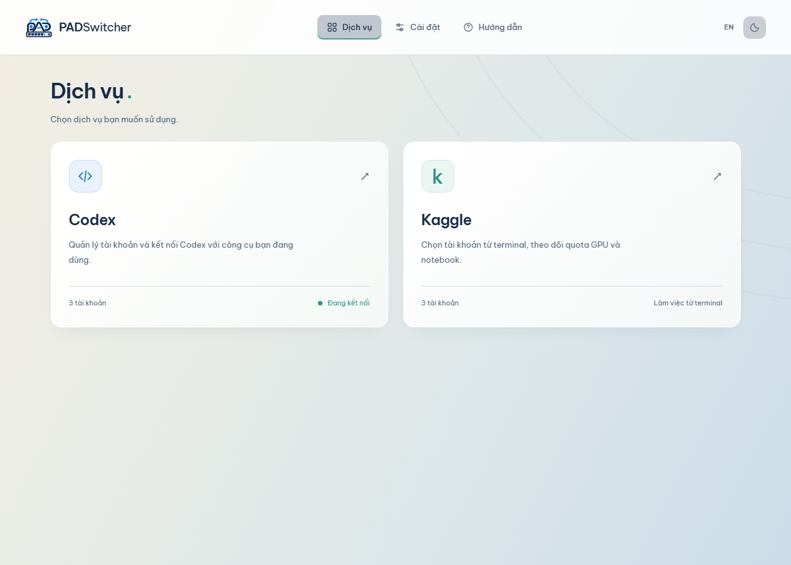

<p align="center">
  
</p>

<h1 align="center">PADSwitcher</h1>

<p align="center">
  <strong>Profile Account Directory Switcher</strong><br>
  <strong>One place to manage Codex and Kaggle accounts on Windows.</strong><br>
  Track quotas, switch accounts safely, and keep working in your IDE or terminal.
</p>

<p align="center">
  <a href="https://github.com/padduwcs/PADSwitcher/releases/latest"></a>
  <a href="https://github.com/padduwcs/PADSwitcher/actions/workflows/ci.yml"></a>
  <a href="LICENSE"></a>
  
</p>

<p align="center">
  <a href="https://github.com/padduwcs/PADSwitcher/releases/latest"><strong>⬇️ Download for Windows</strong></a>
  &nbsp;·&nbsp; <a href="README.md">Tiếng Việt</a>
  &nbsp;·&nbsp; <a href="https://github.com/padduwcs/PADSwitcher/issues/new/choose">Report a bug</a>
</p>

> [!IMPORTANT]
> PADSwitcher is a portable Windows app and is currently **unsigned**. Download it only from the official Releases page and verify the accompanying `.sha256` file.

<p align="center">
  
  
</p>

## Highlights

- 🔄 **Keep Codex moving:** switch manually or retry on a backup account when a confirmed quota error occurs before response output.
- 🧩 **Works where you do:** connect Codex in VS Code, the PowerShell CLI, and JetBrains AI Assistant.
- 📊 **Clear quota visibility:** see remaining allowances, reset times, switch history, and model activity in one app.
- 🚀 **Parallel Kaggle workflows:** select a different account per terminal and monitor GPU/TPU quotas, pinned notebooks, and recent runs.
- 🔐 **Local-first security:** Codex sessions and Kaggle tokens are encrypted with Windows DPAPI.
- 🌗 **Polished UI:** light/dark themes, Vietnamese/English, responsive layouts, and adjustable panes.

<p align="center">
  
  
</p>

## Start in three minutes

### Requirements

- Windows 10/11 x64 and .NET Framework 4.8.
- For Codex: the Windows Codex CLI or VS Code Codex extension. Verified with Codex `0.160.0`.
- For Kaggle: Python 3.11+ and the Kaggle tools described in the app.
- The portable build does not require Node.js.

### Install

1. Download `PADSwitcher-<version>-Windows.exe` and its `.sha256` file from [Releases](https://github.com/padduwcs/PADSwitcher/releases/latest).
2. Verify the download:

   ```powershell
   Get-FileHash .\PADSwitcher-*-Windows.exe -Algorithm SHA256
   ```

3. Open the app → **Services** → choose **Codex** or **Kaggle**.
4. Follow the in-app three-step guide to add an account and connect your tool.

PADSwitcher is portable: put the `.exe` wherever you prefer and run it directly. To update, quit the old version from the system tray and open the new one; data under `%APPDATA%\PADSwitcher\data` is retained.

## Connect Codex

- **VS Code:** choose **Connections → Set up VS Code**, then run `Developer: Reload Window` once.
- **PowerShell/VS Code terminal:** copy the command from **Connections**. The regular `codex` command continues to use its own session.
- **JetBrains/Android Studio:** install AI Assistant and the Codex agent, then select **Codex · PADSwitcher** in AI Chat.

All three client types share one account by default. You can also assign a separate account and auto-switch policy to each client type. See the [complete Codex guide](docs/CODEX.md#english).

## Use Kaggle

1. Open **Services → Kaggle → Setup**, install the suggested tools, then **Save & check**.
2. Create an API token in [Kaggle Settings](https://www.kaggle.com/settings), then choose **Add account**.
3. Select an account → **Copy command** or **Open new terminal**.
4. Submit notebooks with the Kaggle CLI and monitor quotas/runs in PADSwitcher.

Each PowerShell keeps its own account selection, so multiple terminals can use different accounts in parallel within Kaggle's limits. See the [complete Kaggle guide](docs/KAGGLE.en.md).

## Security and boundaries

- PADSwitcher does not run an Internet-hosted proxy. Its gateway listens on loopback only and uses a fresh capability on each start.
- The app does not write prompts or credentials to its own logs. Do not share the app-data directory, connection files, or unredacted screenshots.
- Automatic switching supports personal Codex Free/Plus/Pro accounts and confirmed quota errors before response output.
- Organization accounts, WSL, SSH/containers, Codex cloud, Windows auto-start, and automatic updates are not currently supported.
- Codex sandboxing and tool-approval prompts remain in place.

Read more: [Security](SECURITY.md) · [Routing boundaries](ROUTING.en.md) · [Validation scope](VALIDATION.md)

## Development

```powershell
git clone https://github.com/padduwcs/PADSwitcher.git
cd PADSwitcher
npm ci
npm start
```

Development requires Node.js 24 LTS and Git. Main checks:

```powershell
npm run check
npm test
npm run smoke:ui
npm run dist
```

The native helper is built automatically. See the [development guide](docs/DEVELOPMENT.md), [contributing guide](CONTRIBUTING.md), and [changelog](CHANGELOG.md).

## Community

If something breaks, [open an issue](https://github.com/padduwcs/PADSwitcher/issues/new/choose) with the app version, Windows version, and reproduction steps. Redact account information. Report vulnerabilities through the [security policy](SECURITY.md).

---

<p align="center">
  Released under the <a href="LICENSE">MIT License</a> ·
  <a href="THIRD_PARTY_NOTICES.md">Third-party notices</a><br>
  Independent project; not an official OpenAI, Kaggle, or JetBrains product.
</p>
