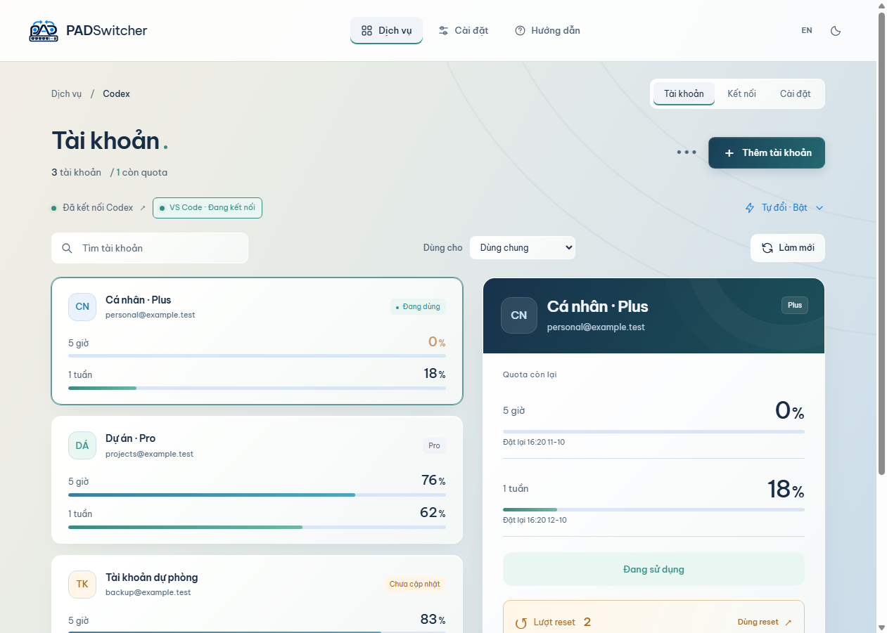
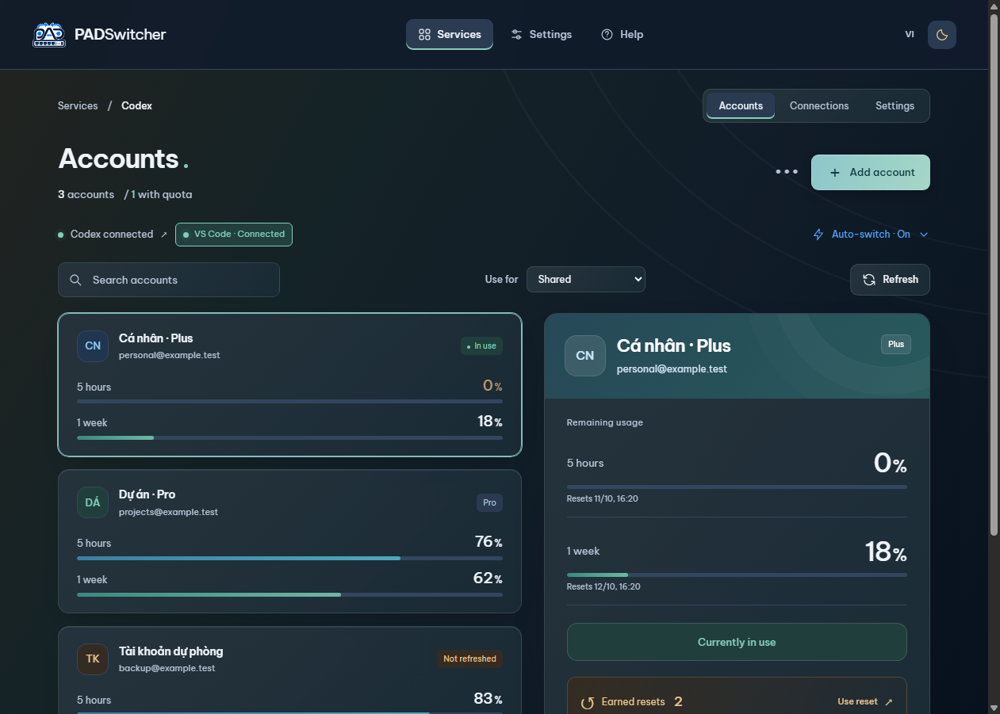

<p align="center"></p>

# PADSwitcher

Quản lý tài khoản **Codex và Kaggle**, theo dõi quota và tự chuyển tài khoản
Codex dự phòng khi tài khoản đang dùng hết quota.

[English](README.en.md) · [Hướng dẫn](docs/README.md) · [Báo lỗi](https://github.com/padduwcs/PADSwitcher/issues/new/choose)

<a id="downloads"></a>
## Tải và cài đặt

**Chỉ muốn sử dụng ứng dụng? Chọn bộ cài bên dưới.** Không cần clone mã nguồn,
cài Node.js hoặc Go. Windows dùng app **PADSwitcher**; Linux/macOS dùng app
**PADSwitcher Unix**, với tài khoản và dữ liệu riêng.

| Hệ điều hành | Bản phát hành | Bộ cài | Hướng dẫn |
| --- | --- | --- | --- |
| Windows 10/11 x64 | [Ổn định](https://github.com/padduwcs/PADSwitcher/releases/latest) | `Windows.exe` portable | [Tiếng Việt](https://github.com/padduwcs/PADSwitcher/blob/main/docs/WINDOWS-INSTALL.md) |
| Ubuntu/Debian x64 hoặc ARM64 | [Unix.7 · thử nghiệm](https://github.com/padduwcs/PADSwitcher/releases/tag/unix-v1.19.1-unix.7) | `.deb` | [Tiếng Việt](https://github.com/padduwcs/PADSwitcher/blob/feature/cross-platform/docs/UNIX-INSTALL.md) |
| Linux khác tương thích | [Unix.7 · thử nghiệm](https://github.com/padduwcs/PADSwitcher/releases/tag/unix-v1.19.1-unix.7) | `.AppImage` | [Yêu cầu Linux](https://github.com/padduwcs/PADSwitcher/blob/feature/cross-platform/docs/UNIX-INSTALL.md) |
| macOS Intel hoặc Apple Silicon | [Unix.7 · thử nghiệm](https://github.com/padduwcs/PADSwitcher/releases/tag/unix-v1.19.1-unix.7) | `.dmg` hoặc `.zip` | [Tiếng Việt](https://github.com/padduwcs/PADSwitcher/blob/feature/cross-platform/docs/UNIX-INSTALL.md) |

Trong trang release, mở **Assets**, chọn đúng hệ điều hành và kiến trúc CPU.
File `.sha256` dùng để kiểm tra bộ cài; mục **Source code** dành cho mã nguồn.
Trên Ubuntu 24.04/26.04, dùng `.deb` thay vì AppImage.

Windows portable chưa ký số. Bản Mac thử nghiệm ký ad-hoc, chưa notarize;
hướng dẫn cài đặt giải thích bước mở app lần đầu. Bản Unix mới không thay thế
bản Windows ổn định ở liên kết **Latest**.

## Bắt đầu sử dụng

1. Cài/mở ứng dụng, vào **Dịch vụ → Codex** và thêm tài khoản qua trình duyệt.
2. Vào **Kết nối**, chọn cách dùng: **VS Code**, **CLI** hoặc **JetBrains**.
   Windows 1.20 và Unix có **Mở desktop qua PADSwitcher** cho Codex cục bộ.
3. Muốn tự đổi khi hết quota: thêm ít nhất hai tài khoản, mở thiết lập tự chuyển,
   chọn tài khoản dự phòng và lưu. Giữ PADSwitcher chạy khi dùng kết nối này.

Desktop Codex dùng thiết lập tự chuyển **Dùng chung**. Extension ở
chế độ Dùng chung dùng cùng thiết lập; kết nối chọn tài khoản riêng có danh sách
riêng. [Hướng dẫn bật tự chuyển từng bước](https://github.com/padduwcs/PADSwitcher/blob/feature/cross-platform/docs/UNIX-INSTALL.md#bật-tự-chuyển-tài-khoản-cho-desktop-và-extension).

Tự chuyển áp dụng cho tài khoản Codex cá nhân Free/Plus/Pro và lỗi quota đã
xác định trước khi có kết quả trả về. Lịch sử ChatGPT thông thường không chuyển
qua tài khoản khác; tác vụ cloud/remote không thuộc kết nối Codex cục bộ này.

**Kaggle:** chọn **Dịch vụ → Kaggle → Thiết lập**, cài công cụ theo hướng dẫn,
thêm API token, rồi mở terminal cho tài khoản cần dùng. Mỗi terminal giữ lựa
chọn tài khoản riêng. Hướng dẫn Kaggle: [Windows](https://github.com/padduwcs/PADSwitcher/blob/main/docs/KAGGLE.md) · [Linux/macOS](https://github.com/padduwcs/PADSwitcher/blob/feature/cross-platform/docs/KAGGLE.md).

<p align="center"></p>

## Clone và phát triển

Repo duy trì hai nhánh. **Chọn đúng nhánh ngay khi clone**:

| Bạn phát triển bản nào? | Nhánh | Thiết lập và chạy |
| --- | --- | --- |
| Windows | `main` | [Hướng dẫn Windows](https://github.com/padduwcs/PADSwitcher/blob/main/docs/DEVELOPMENT.md) |
| Linux/macOS | `feature/cross-platform` | [Hướng dẫn Unix](https://github.com/padduwcs/PADSwitcher/blob/feature/cross-platform/docs/DEVELOPMENT.md) |

Linux/macOS:

```bash
git clone --branch feature/cross-platform https://github.com/padduwcs/PADSwitcher.git
cd PADSwitcher
```

Trên Linux, làm theo phần **Linux** của hướng dẫn Unix để chuẩn bị công cụ và
sandbox. Trên Mac, làm theo phần **macOS**. Windows clone với `--branch main`.
Clone không kèm `--branch` mặc định lấy mã Windows.

Một thư mục mã nguồn là đủ; có thể chuyển nhánh bằng Git sau khi lưu thay đổi.
Ứng dụng đã cài hoạt động độc lập với thư mục mã nguồn.
Xem [đóng góp](CONTRIBUTING.md) và [chuyển nhánh trong một thư mục](https://github.com/padduwcs/PADSwitcher/blob/feature/cross-platform/docs/DEVELOPMENT.md#one-folder-and-two-branches).

## Tài liệu và hỗ trợ

- [Mục lục hướng dẫn](docs/README.md) · [Hỗ trợ](SUPPORT.md) · [Bảo mật](SECURITY.md)
- [Thay đổi Windows](https://github.com/padduwcs/PADSwitcher/blob/main/CHANGELOG.md) · [Thay đổi Unix](https://github.com/padduwcs/PADSwitcher/blob/feature/cross-platform/CHANGELOG.md)
- [Kiểm chứng Unix và giới hạn](https://github.com/padduwcs/PADSwitcher/blob/feature/cross-platform/docs/UNIX-VALIDATION.md)

Phát hành theo [MIT](LICENSE). Dự án độc lập với OpenAI, Kaggle và JetBrains.
