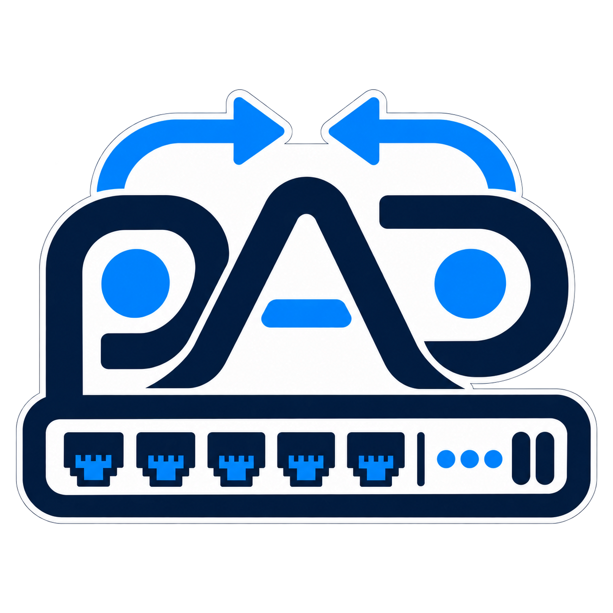

<p align="center"></p>

# PADSwitcher Unix

**Profile Account Directory Switcher — bản Linux và macOS độc lập.**
Quản lý tài khoản Codex/Kaggle, theo dõi quota và kết nối công cụ trên máy.

Nhánh này là `feature/cross-platform`. Bản Windows ổn định tiếp tục ở
[`main`](https://github.com/padduwcs/PADSwitcher/tree/main), với mã nguồn, dữ liệu
và quy trình phát hành riêng. Worktree Unix không thay đổi thư mục Windows đang dùng.

[English](README.en.md) · [Hướng dẫn Unix/WSL](docs/UNIX.md) ·
[Phạm vi kiểm chứng](docs/UNIX-VALIDATION.md) ·
[Build trên GitHub Actions](https://github.com/padduwcs/PADSwitcher/actions/workflows/unix-ci.yml?query=branch%3Afeature%2Fcross-platform)

## Dùng thử

Linux cần desktop có Secret Service/GNOME Keyring đã mở khóa; macOS dùng Keychain.
Codex CLI native tương thích được cài riêng. Kaggle cần Python 3.11+ và các SDK
theo thiết lập trong app. Các gói đã build không cần Node.js hoặc Go.

Artifact build có trong Actions: `.AppImage`/`.deb` cho Linux và `.dmg`/`.zip`
cho macOS, với SHA-256 đi kèm. Bản Unix dùng tag `unix-v…`, được phát hành dưới
dạng **Pre-release** và không thay thế bản Windows ở đường dẫn tải Latest.
Bản Mac preview ký ad-hoc, chưa có Developer ID/notarization.

## Phát triển

Trên Linux/macOS, cài Node.js 24, Go 1.27.2+ và Git:

```bash
git clone --branch feature/cross-platform https://github.com/padduwcs/PADSwitcher.git
cd PADSwitcher
npm ci
npm start
```

Trên máy Windows hiện tại, chạy từ worktree Unix:

```powershell
cd D:\Current_Projects\PADSwitcher-Unix
.\scripts\wsl-dev.ps1 -Task verify
.\scripts\wsl-dev.ps1 -Task start
```

Script WSL dùng dependency và thư mục build riêng trong Linux. `verify` sử dụng
dữ liệu giả và kho khóa tạm, không đọc tài khoản hay sửa cấu hình Windows.

Tài liệu [UNIX.md](docs/UNIX.md) mô tả đầy đủ dependency, thư mục dữ liệu,
Bash/Zsh, giới hạn WSL, kiểm thử và phát hành. Không sao chép kho DPAPI Windows
sang bản Unix; thêm/đăng nhập tài khoản lại trong môi trường Unix.

Phát hành theo [MIT](LICENSE). Dự án độc lập với OpenAI, Kaggle và JetBrains.
