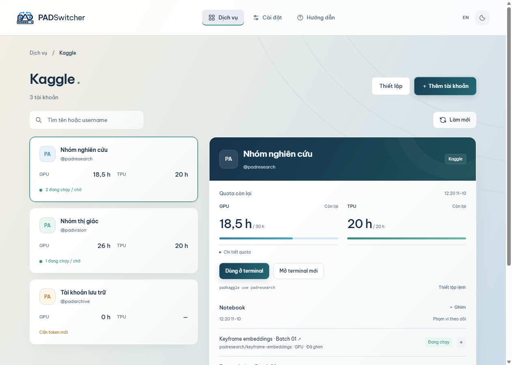

# Using Kaggle on Linux/macOS

[Tiếng Việt](KAGGLE.md)

Open **Services → Kaggle** to store authorized accounts, select one independently in each terminal, and monitor remaining GPU/TPU time and notebook status.

## Start in three steps

1. **Add an account.** Create an API token under [Kaggle Settings → API](https://www.kaggle.com/settings), select **Add account**, and paste the token. If the app reports missing tools, complete **Setup** first.
2. **Select it in a terminal.** Choose an account → **Copy command** → run it in Bash/Zsh, including a VS Code terminal. The terminal keeps that selection when you change folders.
3. **Submit and monitor.** Use the Kaggle CLI to submit a notebook, then return to PADSwitcher to refresh quota and run status. Select another account in another terminal for parallel work within Kaggle's limits.

Kaggle GPU time applies to notebooks running on Kaggle. Running `python train.py` directly still uses your local computer.



## Common tasks

- **Short command:** enable **Setup → Set up padkaggle** once and open a new Bash/Zsh terminal. Use `padkaggle list`, `padkaggle use username`, `padkaggle status`, and `padkaggle off`.
- **New terminal:** choose **Open new terminal** to start Bash with the selected account. Its initial folder comes from account options.
- **Notebooks:** pin a recent notebook or enter its `username/notebook-slug`. Pinned and Recent scroll independently; reaching the end of Recent loads another page.
- **Layout:** drag between columns or below a notebook list. PADSwitcher remembers sizes; **Reset layout** restores automatic sizing.
- **Account maintenance:** use **Account options** to rename an account, change its working folder, replace its token, or remove it.

## Tool setup

PADSwitcher requires Python 3.11+, `kaggle >=2.2.4,<3`, and `kagglesdk >=0.1.37,<1`. It does not bundle Python or install packages silently.

Open **Setup**, copy the provided installation command, run it in Bash/Zsh, then choose **Save & check**. You can select a specific `python3`, including one in a virtual environment.

Use a current Kaggle API token, not a password or legacy `kaggle.json` contents. PADSwitcher verifies the token and discovers its username before saving it.

## Submitting a notebook

In a terminal where the intended account is selected:

```bash
kaggle kernels init -p ./job
```

Edit `job/kernel-metadata.json`: set `id` to `username/notebook-slug`, point `code_file` to your code, add data sources, and set `enable_gpu: true` when required. Then run:

```bash
kaggle kernels push -p ./job
kaggle kernels status username/notebook-slug
kaggle kernels output username/notebook-slug -p ./results
```

The notebook owner in `id` must match the selected account. Use only accounts and resources you are authorized to access.

## Quota and notebook status

- Remaining accelerator time can include reservations; Kaggle decides actual allocation. `—` means no current data.
- PADSwitcher tracks up to 20 pins and loads 12 recent notebooks per page.
- Status reflects the latest run visible through the API and may not include every interactive web session.
- Refresh updates quota, pins, and the first recent page. Additional pages are kept in memory for the current app session.
- Optional automatic refresh runs every two minutes. Read errors retain the previous snapshot and mark it stale.
- Selecting a notebook opens Kaggle in your browser, which may require the matching web login.

## Terminals and credentials

`padkaggle use` changes only the current Bash/Zsh process and keeps its working
directory. Bash 3.2+ and Zsh are supported. Enable the short command once, then
open a new terminal; existing terminals can use **Copy command** to load it.
Unix PADSwitcher and its connected tools must run in the same Linux/macOS environment.

`padkaggle off` restores the previous Kaggle environment and PATH. It does not
stop submitted notebooks or already-running children.

Tokens are encrypted with the Unix keyring-backed vault. A selected terminal
holds its token in process memory/environment. Removing/replacing a token in
PADSwitcher does not revoke copies inherited by open terminals. Close those
terminals and revoke with Kaggle for immediate invalidation.

PADSwitcher manages accounts and reads status. It does not split jobs, schedule work, bypass quota, or automatically rotate Kaggle accounts.

## Implementation and verification

- Metadata lives in the Unix application's `data/kaggle` folder; each token has
  an encrypted vault. Linux uses Secret Service and Mac uses Keychain.
- Renderer snapshots, copied commands, arguments and logs exclude tokens.
- The Python reader receives explicit credentials over stdin, strips inherited
  credential hooks and returns a bounded JSON contract.
- Per-account reads/pagination are deduplicated, identity-checked and cancellable.
- Optional `padkaggle` setup touches only marked Bash/Zsh startup blocks. Linked
  dotfile profiles stay unchanged and can be configured using the shown source line.
- The setup command creates an isolated Python venv by default, preserving system Python.

Routine Node/native/Python/UI checks use synthetic credentials and local fixtures.
They do not make authenticated Kaggle requests or consume compute. Real token,
private-notebook and submission acceptance requires separate authorization.

See [Development](DEVELOPMENT.md), [Security](../SECURITY.md), or the
[Windows Kaggle guide](https://github.com/padduwcs/PADSwitcher/blob/main/docs/KAGGLE.en.md).
