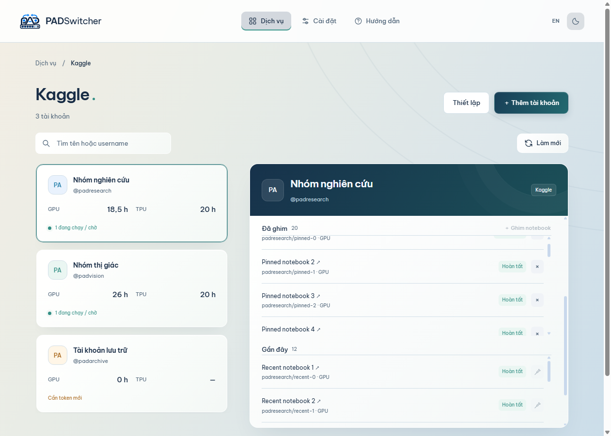

# Kaggle account management

Available in PADSwitcher 1.14.0, with commands for existing PowerShell terminals in 1.14.1. This feature is separate from the Codex gateway and can be used without configuring a Codex connection.

Since 1.15.0, open **Dịch vụ → Kaggle** (Services → Kaggle). Account options and quota details are collapsed until needed; **Dùng ở terminal** is the primary action.

Since 1.16.0, Pinned and Recent have separate scroll areas. Recent loads 12 notebooks per page on downward end scroll, with Load more/Retry buttons for keyboard access and failures. Loaded counts reflect the visible collection, not an API total.



## Luồng sử dụng

**Thiết lập một lần:** mở Dịch vụ → Kaggle → Thiết lập. Chọn `python.exe` của Python 3.11+ hoặc một venv riêng, hoặc để ứng dụng tìm Python trên PATH. Sao chép lệnh cài và chạy trong PowerShell, sau đó Lưu & kiểm tra. Ứng dụng cần `kaggle >=2.2.4,<3` và `kagglesdk >=0.1.37,<1`; không đóng gói Python hay tự cài package. Có thể xem phiên bản của cả ba trong hộp Thiết lập.

**Thêm tài khoản:** tạo API token mới tại Kaggle Settings → API. Nhập token, tên dễ nhớ và thư mục làm việc trong PADSwitcher. Token được kiểm tra qua Kaggle trước khi lưu, nhận diện username tự động. Token trùng tài khoản bị từ chối; cập nhật token phải khớp username đã lưu. Bản đầu hỗ trợ API token hiện đại, không nhập `kaggle.json` dạng username/key cũ.

**Dùng terminal đang mở:** chọn tài khoản → **Dùng ở terminal**, dán lệnh được sao chép vào PowerShell, gồm PowerShell trong VS Code. Terminal đó nhận tài khoản đã chọn và giữ nguyên thư mục hiện tại. Không cần nhập lại token hoặc mở cửa sổ mới.

**Bật lệnh ngắn một lần:** chọn **Thiết lập lệnh → Bật lệnh padkaggle**. PADSwitcher thêm một đoạn được đánh dấu riêng vào profile người dùng của Windows PowerShell và PowerShell 7, giữ các cấu hình khác. Terminal mới có thể gọi:

```powershell
padkaggle list
padkaggle use username_a
kaggle kernels list --mine
padkaggle use username_b
padkaggle status
padkaggle off
```

`use` chọn tài khoản cho chính tiến trình PowerShell đang chạy. Có thể dùng tên dễ nhớ trong dấu nháy, ví dụ `padkaggle use 'Nhóm nghiên cứu'`, nếu tên không trùng; username luôn được ưu tiên. Không tự chọn tài khoản khi mở terminal. Terminal đang mở trước khi bật profile dùng nút sao chép ở trên để nạp lệnh ngay. Các phiên khởi động với `-NoProfile` cũng cần nạp bằng lệnh sao chép. Nếu chính sách PowerShell chặn script, cần giải quyết theo chính sách máy; PADSwitcher không bỏ qua execution policy. CMD, Git Bash và WSL chưa hỗ trợ lệnh chọn tài khoản tại chỗ này.

Mỗi terminal giữ lựa chọn riêng: terminal thứ nhất dùng A, terminal thứ hai dùng B; đổi lựa chọn chỉ ảnh hưởng các lệnh bắt đầu sau đó trong terminal đó. `status` cho biết lựa chọn cục bộ, không xác minh token trực tuyến. `off` khôi phục các biến Kaggle trước lần chọn đầu tiên và gỡ các đường dẫn công cụ do lệnh thêm, giữ những thay đổi PATH khác. Nó không dừng tiến trình đã chạy, job trên Kaggle hay thu hồi token. Có thể gỡ đoạn profile tại **Thiết lập lệnh**; terminal đã mở vẫn giữ lựa chọn cho tới `off` hoặc khi đóng.

**Mở terminal mới từ ứng dụng:** chọn tài khoản rồi **Mở terminal mới**. PowerShell mới dùng cùng lệnh `padkaggle`, với Kaggle CLI từ môi trường Python đã chọn, và mở tại thư mục đã lưu. Có thể mở terminal của A, B, C cùng lúc. `cd` đến thư mục nào cũng giữ tài khoản của terminal. Bạn tiếp tục sửa code trong VS Code bình thường.

Ví dụ gửi code local lên Kaggle:

```powershell
kaggle kernels init -p ./job-a
# Sửa ./job-a/kernel-metadata.json: id, code_file, nguồn dữ liệu,
# enable_gpu: true nếu cần GPU. id phải là username/notebook-slug.
kaggle kernels push -p ./job-a
kaggle kernels status username/notebook-slug
kaggle kernels output username/notebook-slug -p ./results
```

Gửi job khác từ terminal của tài khoản B bằng cấu hình notebook có username của B. Dùng các tài khoản được phép truy cập và tuân thủ giới hạn, điều khoản Kaggle. PADSwitcher không gửi code, chia dữ liệu, lên lịch, tự đổi tài khoản hay can thiệp vào giới hạn chạy. `python train.py` trong terminal này vẫn chạy bằng CPU/GPU local; GPU Kaggle chỉ phục vụ notebook chạy trên Kaggle.

**Theo dõi:** quota GPU/TPU lấy từ API chính thức, gồm số giờ còn lại, tổng, giữ chỗ và thời điểm đặt lại nếu có. Số giờ còn lại là tổng trừ đã dùng, còn bao gồm phần giữ chỗ; đây không phải bảo đảm GPU còn sẵn. `—` nghĩa là chưa biết, không phải 0.

**Đã ghim** và **Gần đây** có vùng cuộn riêng; phần chi tiết tài khoản cũng cuộn để trang không dài theo số notebook. Gần đây tải 12 notebook mỗi trang khi cuộn xuống cuối hoặc bấm **Tải thêm**. Nếu có lỗi, danh sách đã tải được giữ và có nút **Thử lại**. Số bên cạnh tên mục là số notebook hiện đã tải trong mục đó, không phải tổng trên Kaggle. Notebook đã ghim chỉ xuất hiện ở Đã ghim, có thể ghim nhanh từ Gần đây hoặc nhập `username/notebook-slug` / URL `https://www.kaggle.com/code/username/notebook-slug`, tối đa 20 mục có quyền xem.

Mỗi notebook hiển thị lượt chạy mới nhất. API không cung cấp đầy đủ mọi phiên tương tác trên web hoặc mọi phiên bản đang chạy. **Làm mới** cập nhật quota, trang đầu và các notebook ghim; các trang tải thêm giữ ảnh chụp tại lúc tải trong phiên mở app, rê chuột lên trạng thái để xem thời điểm đọc. Đóng rồi mở lại app sẽ bắt đầu từ trang đầu. Kaggle phân trang theo thời điểm chạy nên danh sách có thể thay đổi trong lúc đọc; PADSwitcher loại trùng theo đường dẫn notebook. Trạng thái không phải sự kiện trực tiếp liên tục. Nút mở notebook dẫn tới Kaggle để xem thêm; có thể cần đăng nhập tài khoản phù hợp trong trình duyệt.

Tự cập nhật mỗi hai phút khi PADSwitcher mở; các lượt làm mới tất cả đọc tối đa hai tài khoản đồng thời. Có thể tắt. Lỗi mạng, giới hạn yêu cầu hoặc thiếu quyền giữ lại dữ liệu cũ và đánh dấu; token hết hạn cần cập nhật. Ghim notebook không cấp thêm quyền xem. PADSwitcher chỉ theo dõi các notebook mà token truy cập được.

**Xóa hoặc thoát:** xóa tài khoản sẽ xóa token đã lưu trong PADSwitcher. Terminal đã mở giữ token trong môi trường tiến trình cho tới khi đóng; thay token trong ứng dụng cũng không cập nhật terminal cũ. Muốn ngắt truy cập hoàn toàn, đóng terminal và thu hồi token trong Kaggle. Đóng PADSwitcher không dừng terminal hay job đã gửi lên Kaggle.

## Storage and implementation

- Metadata: `%APPDATA%\PADSwitcher\data\kaggle\accounts.json`.
- Pagination stores additional rows and their read times in memory per account; persisted snapshots remain bounded to the first 12 plus up to 20 pins. Page requests verify identity, skip quota/pinned queries, deduplicate simultaneous requests per account and retain the cursor on failure. They cannot mutate or remove an account while its read is active.
- Credential vault: `kaggle\<UUID>\token.dpapi`, Windows DPAPI CurrentUser and the existing PADSwitcher entropy. The Kaggle directory has the same private Windows ACL policy as Codex data.
- The renderer receives allowlisted metadata and safe errors. Token input is masked and cleared on submission, cancellation, Escape and dialog close. Tokens are never put in command arguments, clipboard commands, plaintext launchers or metadata files.
- The Python reader uses the official `kagglesdk` client with an explicit API token and production endpoint. Credentials travel over the subprocess stdin pipe. Inherited Kaggle credentials and Python environment hooks are removed; Python starts with `-E -P` to ignore environment configuration and unsafe import paths while allowing normal user-site installations.
- The Python bridge is ASAR-unpacked for portable builds. Packages remain user-installed. SDK stdout/stderr and raw HTTP errors are not forwarded; only the reader’s JSON contract is returned. Request timeout is 12 seconds; the overall reader is bounded to 90 seconds.
- Quitting cancels pending read-only bridge processes and retains the last successful snapshot. Invalid Kaggle storage disables Kaggle mutations while leaving Codex available; the invalid file is preserved for repair.
- Terminal startup decrypts the vault inside PowerShell and sets process-only `KAGGLE_API_TOKEN`. Per-account `KAGGLE_CONFIG_DIR` keeps CLI preferences separate. A deliberately invalid legacy key prevents a rejected modern token from silently falling back to the machine’s default saved account in Kaggle CLI 2.2.4. It does not grant access. No user-level environment variable or default `.kaggle` credential file is changed.
- `terminal/padkaggle.ps1` and its read-only Python dependency reader are exported from the packaged app to a stable path. The shell command reads saved metadata and DPAPI vaults directly, without rewriting account storage or requiring the app to remain open. It resolves and validates the account, tools and vault before changing the caller's environment; failures retain the prior selection. Credentials are never part of copied commands or profile blocks.
- Optional profile setup modifies only the marked PADSwitcher block in the user's all-hosts `profile.ps1` files for Windows PowerShell and PowerShell 7. Existing UTF-8/UTF-16LE encodings are preserved; malformed blocks, unsupported encodings, signed profiles and linked files are left alone. Concurrent profile edits cause setup to stop and roll back files it has already changed when they remain unchanged.
- The token is necessarily present in memory and in that terminal’s environment. Software running as the same Windows user can read it; DPAPI is protection at rest, not isolation from the current user.

## Verification and boundaries

The normal Node suite covers encrypted storage, reload, duplicate/identity checks, rollback on disk errors, per-account refresh deduplication, simultaneous account reads, partial snapshots, pinning limits, dependency failures, safe error messages, independent launches and UI workflows. Windows tests decrypt synthetic tokens in simultaneous hidden PowerShell processes and verify in-place switching, safe failures, PATH restoration, profile preservation and environments without printing tokens. PowerShell 7 is checked when installed, including in Windows CI.

For the real SDK request/response contract, install the stated packages in a disposable venv and run:

```powershell
& '<venv>\Scripts\python.exe' -I test/kaggle-reader-test.py
```

This offline suite uses real SDK model types and fixture clients; it makes no Kaggle requests. It checks requested pages, full/short/empty page handling, invalid paging and safe partial errors. Electron smoke checks include the Kaggle page in light/dark, VI/EN and 1000/1260px layouts, with 20 pins, independently bounded scroll areas, incremental loading and scroll preservation. If `artifacts/kaggle-sdk-probe/Scripts/python.exe` exists, startup and packaged smoke also verify the actual Python bridge and tool detection without authentication.

Live acceptance checks use two authorized real Kaggle accounts to verify token creation/revocation, account-specific CLI submissions, parallel jobs, quota and private notebook status. These workflows have not been executed by the automated checks; they require real tokens and consume Kaggle compute when jobs run.

Primary references: [official Kaggle CLI](https://github.com/Kaggle/kaggle-cli), [Kaggle API documentation](https://www.kaggle.com/docs/api), [Kaggle Settings](https://www.kaggle.com/settings). The implementation was checked against locally installed `kaggle 2.2.4` and `kagglesdk 0.1.37`.
